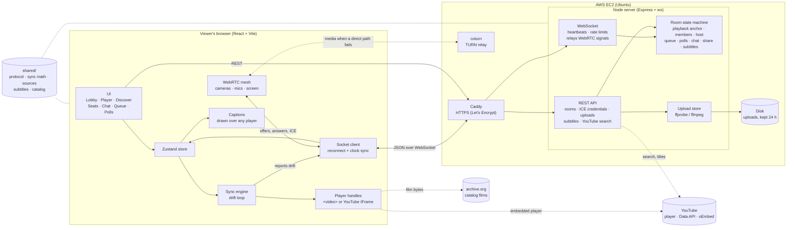
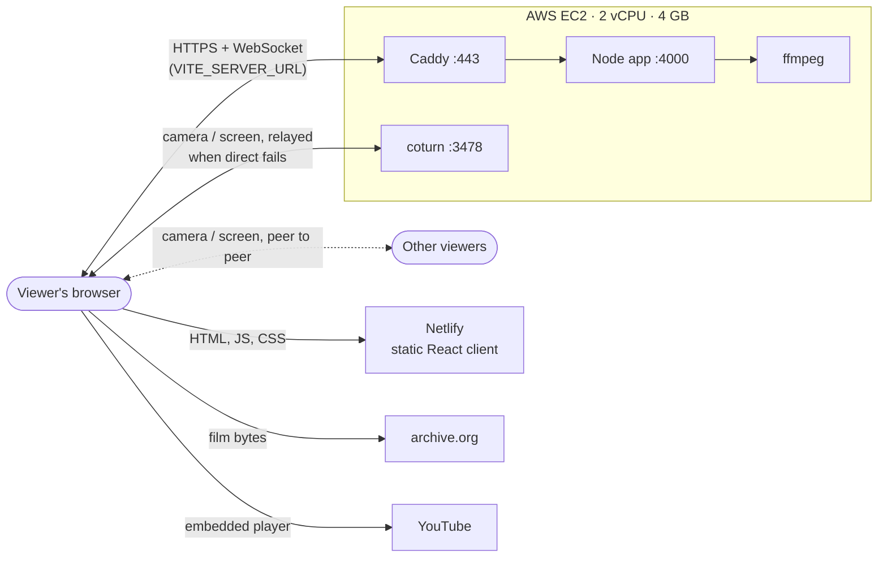
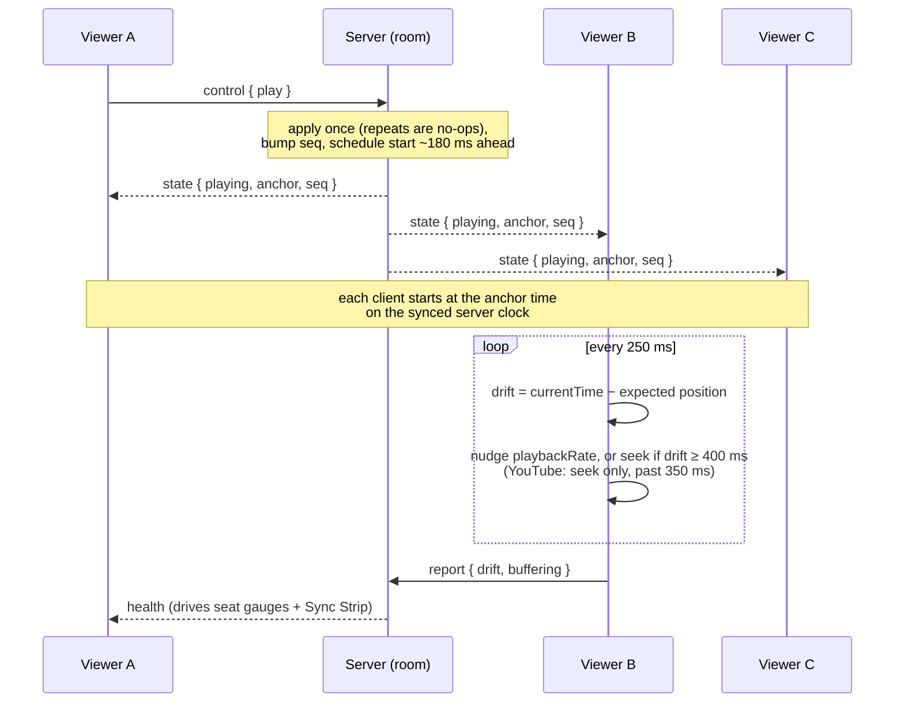
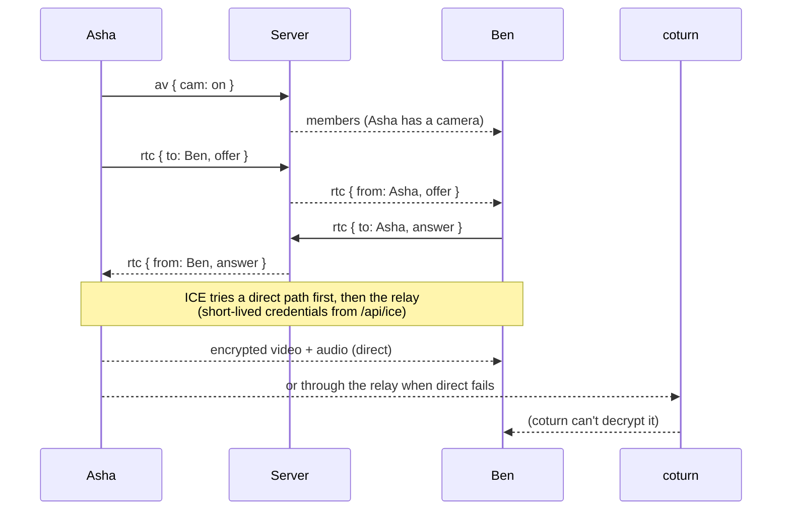
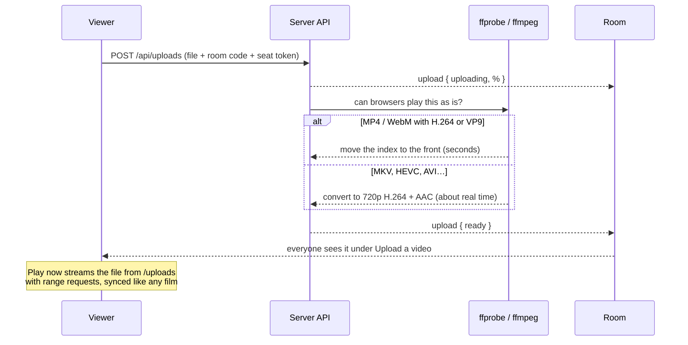

<div align="center">

# 🍿 Watch Party

### Same movie. Same second.

Watch together in lockstep with friends: a free film, a YouTube video, a file you upload, or someone's screen. Start a room, share the link, and everyone's play, pause and seek stay in sync, with cameras, live chat, reactions, subtitles, a shared queue and group polls along for the ride.

**Built by [Dharoon Balajii](https://github.com/DharoonBalajii) for VinnovateIT Recruitment'26**

### 🔗 [Live demo → watch-party-vinnovateit-recruitment.netlify.app](https://watch-party-vinnovateit-recruitment.netlify.app/)

<sub>Runs on its own AWS EC2 server, so it's always on. Also at <a href="https://13-204-43-176.sslip.io">13-204-43-176.sslip.io</a>.</sub>

    

</div>

---

## Try it live

**[Open the live site](https://watch-party-vinnovateit-recruitment.netlify.app/)**, enter a name and press **Start a room**. To test syncing, open the invite link in a second tab or on your phone, then press play in one and watch the other follow.

Things to try once you're in: paste a YouTube link (or search YouTube), upload a video from your computer, add a `.srt` subtitle file with **CC**, turn on your camera to put your face on your seat, or press **Share screen**. Cameras and screen sharing need HTTPS, which the live site has.

## Quick start (run it yourself)

You need **Node 20.19+** (check with `node -v`) and a modern browser. No database and no accounts. Two optional extras:

- **ffmpeg** on your `PATH` lets uploads take any format (MKV, MOV, AVI, HEVC…). Without it, uploads accept MP4 and WebM only.
- **`YOUTUBE_API_KEY`** turns on YouTube search. Without it, pasting YouTube links still works.

```bash
git clone https://github.com/DharoonBalajii/Watch-Party-VinnovateIT.git
cd Watch-Party-VinnovateIT
npm install
npm start
```

Open **http://localhost:4000**, enter a name, press **Start a room**, and send the invite link to a friend.

`npm start` also prints a **Network** address such as `http://192.168.1.20:4000`. Anyone on the same Wi-Fi can open it and join your room.

| I want to… | Run |
| --- | --- |
| Use the app | `npm start` |
| Develop with hot reload (client on :5173) | `npm run dev` |
| Run the unit tests | `npm test` |
| Check that every movie URL works | `npm run verify-catalog` |
| Load-test the server | `npm run loadtest` |
| Test in real browsers | `npm run build && npm run e2e` |
| Test links, webcams and screen share in real browsers | `npm run build && npm run e2e:av` |

> Videos stream from archive.org, so playback needs an internet connection. To serve your own files from the LAN instead, drop them in `server/media/` (they appear at `/media/<file>`).

## Features

**Rooms**
- Create and join through an invite link (`/r/KQTM72`) or a six-character code.
- Up to 50 viewers per room, with a clear message when it's full.
- Host controls, automatic host transfer if the host disappears, and a "host only" mode.
- The host can remove someone (they can't rejoin from that seat) and lock the room so nobody new can join.

**Synced playback**
- Play, pause and seek reach everyone together, even when several people act at once.
- Automatic drift detection and correction, so nobody quietly falls behind.
- Late joiners land on the right frame; dropped connections rejoin their own seat.

**Discover**
- 21 public-domain and Creative-Commons films: Blender open movies, silent-era classics, and public-domain features.
- Recommendation rails ("More like this", "Quick watches", "Lights off"…).
- Filters by genre, mood, length and era, plus typo-tolerant fuzzy search.

**Bring your own**
- **YouTube:** search YouTube from the app, or paste any link (`watch?v=`, `youtu.be`, Shorts, live). It plays in sync through YouTube's player. Drift is fixed by seeking, because YouTube can't vary its speed smoothly.
- **YouTube quality:** pick Auto, 1080p, 720p or 480p for yourself. YouTube no longer lets embeds set quality, so the player is sized to the quality you pick (YouTube chooses by player size).
- **Upload a video:** drop a file up to 4 GB. MP4 and WebM are ready almost as soon as they arrive; MKV, MOV, AVI, HEVC and others are converted to 720p H.264 by ffmpeg on the server (about real time). Uploads are deleted after 24 hours.
- **Direct links:** paste a `.mp4` or `.webm` URL and it plays like a catalog film, with full drift correction.
- **Subtitles:** add a `.srt` or `.vtt` file and the whole room gets the same captions, in sync, on any source. Each viewer can hide them.
- Links and uploads work everywhere titles do: play now, queue, vote and polls.

**Faces and screens**
- Camera and mic: your face appears on the back of your seat and the room hears you (WebRTC, peer to peer).
- Share screen: your screen replaces the film for everyone, and the film pauses underneath. Picking a film takes the screen back.
- A TURN relay (coturn) carries calls when two viewers can't connect directly, e.g. on campus Wi-Fi.

**Together**
- Emoji reactions that float up from the sender's seat (keys `1`–`7`).
- Live chat with typing indicators.
- Shared queue with up-votes and auto-advance, and group polls whose winner joins the queue.

### Creative extras

| | |
| --- | --- |
| 🎞️ **Sync Strip** | The seek bar is a film strip. Every viewer is a pin on it (green, amber or red by drift), and reactions are stamped to the timecode so the room's best moments glow as a heat-map. |
| 💺 **Seat row** | Viewers sit in a row of cinema seats with a live drift gauge, buffering ring, host crown and typing dots. Turn your camera on and your face appears on the back of your seat. |
| 🎬 **Start together** | A ready check followed by a film-leader 3-2-1 that lands on the same instant for everyone. |
| ⏸️ **Hold for stragglers** | If someone's video is buffering, the room pauses and resumes together. |
| 📡 **Sync health** | A live panel with round trip, clock offset, your drift and the control latency your device has measured. |

## Results

Measured, not estimated. Full methods and caveats are in **[docs/LATENCY.md](docs/LATENCY.md)**.

| Requirement | Target | Measured |
| --- | --- | --- |
| Users per room | ≥ 10 | 50 seats; tested with 10, 25 and 50 simulated viewers and 11 real Chrome pages |
| Control propagation (p95) | ≤ 250 ms | **2–3 ms** on loopback, **46–47 ms** with 15 ms ± 10 ms emulated each way |
| Drift after correction | ≤ 500 ms | **max 83 ms** steady state; recovered from a 2 s error in **153 ms** |
| Reliability | late joins, reconnects, concurrent actions | All checked, including chaos runs |
| Everything beyond the catalog | links, uploads, subtitles, cameras, screen share, host tools | **20 of 20** real-browser checks pass against the live EC2 server (`E2E_BASE=… npm run e2e:av`), including a 1080p HEVC `.mkv` converted on the server and played on two browsers |

Loopback is a best case. Real Wi-Fi with packet loss was not tested.

## Architecture



**Where it runs**



The same EC2 address also serves the client itself, so the app works there without Netlify.

**What happens when someone presses play**



**How a camera reaches another viewer**



Each pair of viewers has one connection carrying cameras, mics and screen share. That works well for about six cameras; bigger calls would need a media server (SFU).

**What happens to an upload**



## How the sync works

```
 client ──control(play/pause/seek)──▶ server ──state{anchor, seq}──▶ every client
                                       │
                          one authoritative anchor per room
```

1. **One anchor.** The server keeps `{ videoId, status, anchorPos, anchorServerTime, seq }`. The playhead at any moment is `anchorPos + (serverNow − anchorServerTime)` while playing. A late joiner or a reconnecting client needs just one message to be correct.
2. **Synced clocks.** Each client runs NTP-style pings and keeps the median offset of its lowest-RTT samples, so everyone evaluates the anchor on the server's clock.
3. **Controls are intents.** `play`, `pause` and `seek` are idempotent, so two people pressing pause together produce one change. The server orders everything with `seq`, and clients drop anything stale. Playback starts ~180 ms in the future so everyone begins at the same instant.
4. **Drift loop** (every 250 ms): under 50 ms do nothing; up to 400 ms nudge `playbackRate` by 3–12 % (no visible jump); beyond that, hard-seek.
5. **Failure handling:** heartbeats, 30 s seat grace on reconnect, rate limits, payload caps and input sanitising. The full table is in [docs/LATENCY.md](docs/LATENCY.md).

## Project layout

```
shared/    protocol types, sync math, sources (catalog / YouTube / link / upload), subtitles, catalog
server/    Express + ws: rooms.ts (room state machine), uploads.ts (ffmpeg), youtube.ts (search)
client/    Vite + React + TypeScript
             net/          socket client, sync engine, player handles (media.ts), WebRTC (rtc.ts), uploads
             components/   player, stage menus (CC, quality), Discover tabs, seats, chat, queue, polls
deploy/    ec2/setup.sh (server setup) and ec2/deploy.sh (ship from your machine)
scripts/   loadtest.ts, e2e-drift.ts, e2e-av.ts, verify-catalog.ts
docs/      LATENCY.md and the raw JSON results
```

**Stack:** Node, Express, `ws`, React, Vite, TypeScript, Zustand, Fuse.js, WebRTC, the YouTube IFrame Player and Data APIs, ffmpeg, Caddy, coturn, Vitest and Playwright. Fonts (Big Shoulders Display, Instrument Sans, DM Mono) are bundled.

## Deploy

The live setup is **Netlify for the client** and **one AWS EC2 server** for everything else. The server can also serve the client by itself.

### 1. The server (AWS EC2)

One small VM runs the app, HTTPS (Caddy), the TURN relay (coturn) and ffmpeg. It never sleeps. Cameras and screen sharing need HTTPS, which Caddy sets up on its own; with no domain, it uses `<your-ip>.sslip.io`.

1. Launch Ubuntu 24.04 or newer (2 vCPU and 4 GB is plenty for several rooms). Give it an **Elastic IP** so its address survives restarts.
2. In the instance's security group, allow inbound **TCP 22, 80, 443**, **TCP+UDP 3478** and **UDP 49160–49200**.
3. From your machine:

   ```bash
   EXTRA_ORIGINS=https://your-site.netlify.app deploy/ec2/deploy.sh ubuntu@<public-ip> ~/path/to/key.pem   # optional 3rd argument: your domain
   ```

   On the first run it installs Node 22, Caddy, coturn and ffmpeg. Then, every run, it copies the code, builds and restarts the `watchparty` service. Run it again to ship an update.

| Setting (in `/etc/watchparty.env`) | What it does |
| --- | --- |
| `EXTRA_ORIGINS` (deploy-time) | Other sites allowed to use this server's API, e.g. your Netlify URL |
| `YOUTUBE_API_KEY` | Turns on YouTube search. Create one in Google Cloud (YouTube Data API v3). Pass it once to `deploy.sh`; later runs keep it |
| `UPLOAD_MAX_GB` / `UPLOAD_TOTAL_GB` | Per-file and total upload limits (4 GB / 12 GB) |
| `TURN_SECRET` | Generated on first run; signs 12-hour TURN credentials |

Logs: `sudo journalctl -u watchparty -u caddy -u coturn -f`.

### 2. The client (Netlify)

Import the repo; `netlify.toml` holds the build settings and `VITE_SERVER_URL`, which points the client at the EC2 server. Every push to `main` redeploys. If the server's address changes, update `VITE_SERVER_URL` in `netlify.toml`.

### Render (old free-tier option)

`render.yaml` still runs the realtime server on Render's free tier, but it sleeps when idle, has no ffmpeg or persistent disk for uploads, and no TURN relay. Use EC2 instead.

## Troubleshooting

| Problem | Fix |
| --- | --- |
| `npm start` says the port is in use | Run `PORT=4010 npm start`, or stop whatever is using port 4000. |
| A friend can't open the Network link | Make sure you're on the same Wi-Fi and your firewall allows Node on port 4000. |
| The screen says "Tap to join the screening" | Your browser blocks sound until you tap once. Tap it and you're in. |
| The video stays black | Check your internet connection (videos stream from archive.org), or try another title. |
| `npm run e2e` fails | It needs Google Chrome and a small clip: `curl -L -o server/media/test-clip.mp4 https://download.blender.org/durian/trailer/sintel_trailer-480p.mp4` |
| Camera or Share screen does nothing | Browsers only allow them on `https://` or `localhost`. Check the address bar, and allow the camera when asked. |
| A friend's camera never appears | Their network may block direct calls. Check that UDP 3478 and 49160–49200 are open on the server so the relay can carry it. |
| An upload says "Converting" for a long time | MKV, MOV, AVI and HEVC files are converted at about real time, so a 2-hour film takes about 2 hours. MP4 (H.264) files skip this. |
| YouTube search says it isn't set up | Add a `YOUTUBE_API_KEY` (see Deploy). Pasting YouTube links works without it. |
| A YouTube video won't play | Its owner may have turned off embedding. Try another video. |

## Notes

- Rooms live in server memory, so restarting the server closes them. Uploads and subtitles are deleted after 24 hours. There are no accounts; a viewer is a name and a seat color, and the name is never saved between visits.
- Posters are generated typography, not artwork, so there are no image licenses to worry about.
- Film licences: Blender open movies are CC BY (Blender Foundation); the other titles are public domain. YouTube videos play through YouTube's own player, and uploads are only visible to people in that room.
- Cameras and screens are encrypted between viewers (DTLS-SRTP), including when they pass through the relay. Nothing is recorded.

---

<div align="center">

Made with care by **Dharoon Balajii** · **VinnovateIT Recruitment'26**

</div>
